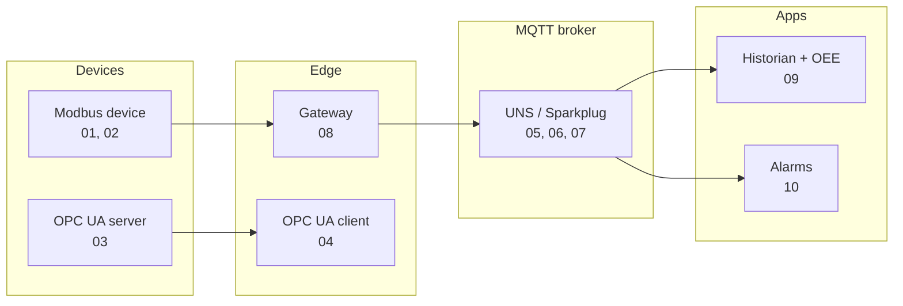

# IIoT Protocols by Example

[](https://github.com/MatheusEduGarcia/iiot-protocols-examples/actions/workflows/ci.yml)

Ten small, runnable Python examples of the protocols and patterns behind
industrial data: Modbus, OPC UA, MQTT, Unified Namespace, Sparkplug B,
edge gateways, historians, OEE and alarm management.

Each example is one or two files, simulates its own device, runs on a
laptop with no hardware, and prints what it is demonstrating. Every one of
them also runs as a test in CI.

| # | Example | Concepts |
|---|---|---|
| 01 | [Modbus TCP basics](01-modbus-tcp-basics/) | coils, discrete inputs, input and holding registers, function codes, unit id, closed-loop control |
| 02 | [Modbus data types and RTU framing](02-modbus-data-types-rtu/) | float32 word order, int32, two's complement, scaling, 4-20 mA NAMUR, status bits, CRC-16, RTU vs TCP frame |
| 03 | [OPC UA server with an information model](03-opcua-server-model/) | object types, folders, engineering units, EURange, access levels, methods |
| 04 | [OPC UA client](04-opcua-client-subscriptions/) | browse, metadata, write, method calls, subscriptions vs polling, deadband |
| 05 | [MQTT QoS, retain and Last Will](05-mqtt-qos-retain-lwt/) | retained state, LWT, QoS 0 vs 1, persistent sessions |
| 06 | [Unified Namespace](06-unified-namespace/) | ISA-95 topic hierarchy, OT and IT producers, wildcard consumers |
| 07 | [Sparkplug B](07-sparkplug-b/) | NBIRTH/DBIRTH/DDATA/NDEATH, aliases, bdSeq, sequence gaps, protobuf |
| 08 | [Modbus to MQTT gateway](08-modbus-to-mqtt-gateway/) | tag table, report by exception, deadband, heartbeat, signal quality |
| 09 | [Historian and OEE](09-historian-and-oee/) | narrow time-series table, window functions, downtime Pareto, Availability x Performance x Quality |
| 10 | [Alarm management (ISA-18.2)](10-alarms-isa-18-2/) | alarm states, acknowledge, deadband, on/off delay, shelving, alarm flood |

## Study notebooks (pt-BR)

Every example also has an **executed study notebook** in its folder, written in Portuguese as class material: concept first, then each step run with its output kept, and an interpretation of every result (plots included).

| # | Notebook |
|---|---|
| 01 | [`01_estudo_modbus_tcp.ipynb`](01-modbus-tcp-basics/01_estudo_modbus_tcp.ipynb) |
| 02 | [`02_estudo_tipos_de_dados_rtu.ipynb`](02-modbus-data-types-rtu/02_estudo_tipos_de_dados_rtu.ipynb) |
| 03 | [`03_estudo_servidor_opcua.ipynb`](03-opcua-server-model/03_estudo_servidor_opcua.ipynb) |
| 04 | [`04_estudo_cliente_opcua.ipynb`](04-opcua-client-subscriptions/04_estudo_cliente_opcua.ipynb) |
| 05 | [`05_estudo_mqtt_qos_retain_lwt.ipynb`](05-mqtt-qos-retain-lwt/05_estudo_mqtt_qos_retain_lwt.ipynb) |
| 06 | [`06_estudo_unified_namespace.ipynb`](06-unified-namespace/06_estudo_unified_namespace.ipynb) |
| 07 | [`07_estudo_sparkplug_b.ipynb`](07-sparkplug-b/07_estudo_sparkplug_b.ipynb) |
| 08 | [`08_estudo_gateway_modbus_mqtt.ipynb`](08-modbus-to-mqtt-gateway/08_estudo_gateway_modbus_mqtt.ipynb) |
| 09 | [`09_estudo_historiador_oee.ipynb`](09-historian-and-oee/09_estudo_historiador_oee.ipynb) |
| 10 | [`10_estudo_alarmes_isa_18_2.ipynb`](10-alarms-isa-18-2/10_estudo_alarmes_isa_18_2.ipynb) |

The notebooks start their own Modbus and OPC UA servers in the background; 05 to 09 need the MQTT broker (`docker compose up -d`). Open them with `jupyter lab` from the repository root.

## How the pieces fit



## Setup

```bash
git clone https://github.com/MatheusEduGarcia/iiot-protocols-examples.git
cd iiot-protocols-examples
python -m venv .venv && source .venv/bin/activate      # Windows: .venv\Scripts\activate
pip install -r requirements.txt
docker compose up -d          # MQTT broker for examples 05 to 09 (or any broker on localhost:1883)
```

Then run any example from the repository root, for instance:

```bash
python 02-modbus-data-types-rtu/datatypes.py
```

Examples 01, 03 and 08 need a server running in another terminal; their
README says which.

## Tests

```bash
pytest -v tests
```

The suite starts the Modbus and OPC UA servers itself and skips the MQTT
examples if no broker is listening on `localhost:1883`.

## Environment variables

| Variable | Default | Used by |
|---|---|---|
| `MQTT_HOST`, `MQTT_PORT` | `localhost`, `1883` | 05 to 09 |
| `MODBUS_HOST`, `MODBUS_PORT` | `localhost`, `5020` | 01, 08 |
| `OPCUA_URL` | `opc.tcp://localhost:4841/iiot-examples/` | 04 |

## Related

* [compressed-air-plant-opcua](https://github.com/MatheusEduGarcia/compressed-air-plant-opcua):
  these concepts together in one plant: PLC, OPC UA, UNS, TimescaleDB, Grafana.
* [automation-portfolio](https://github.com/MatheusEduGarcia/automation-portfolio):
  ESP32 and Node-RED projects.

## Author

**Matheus Garcia**, Control and Automation Engineer, OT/IT integration and
industrial data. [LinkedIn](https://www.linkedin.com/in/matheuseduardorgarcia)

MIT License
