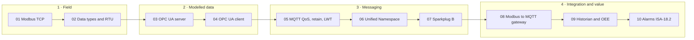
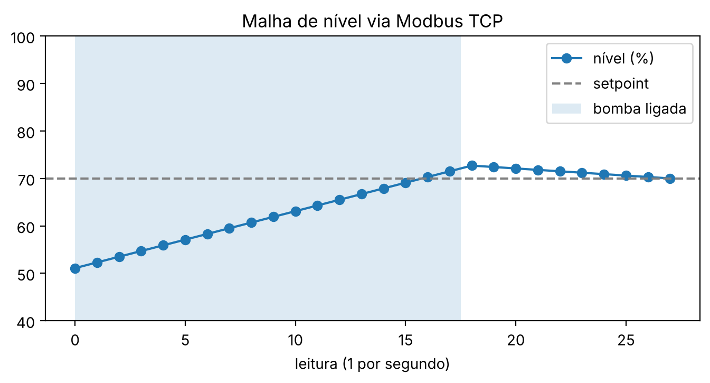
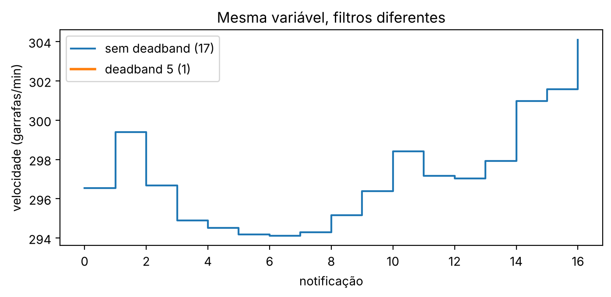
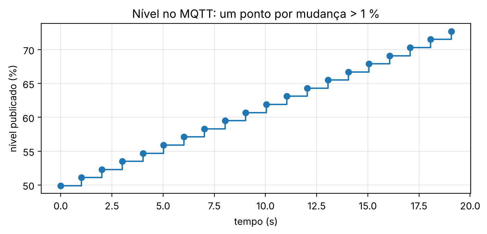
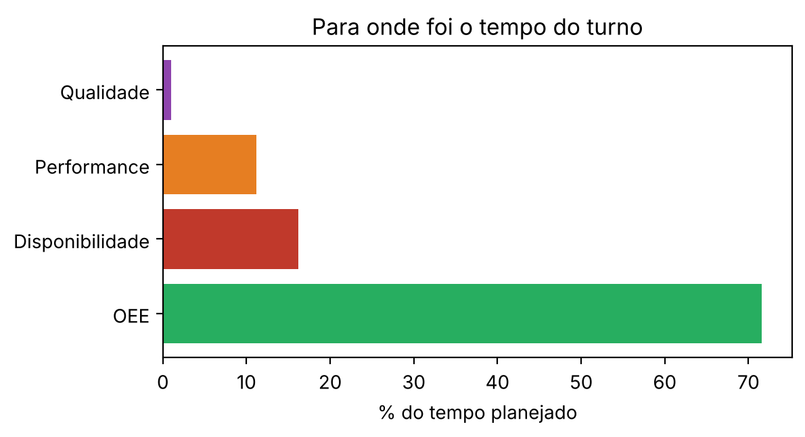
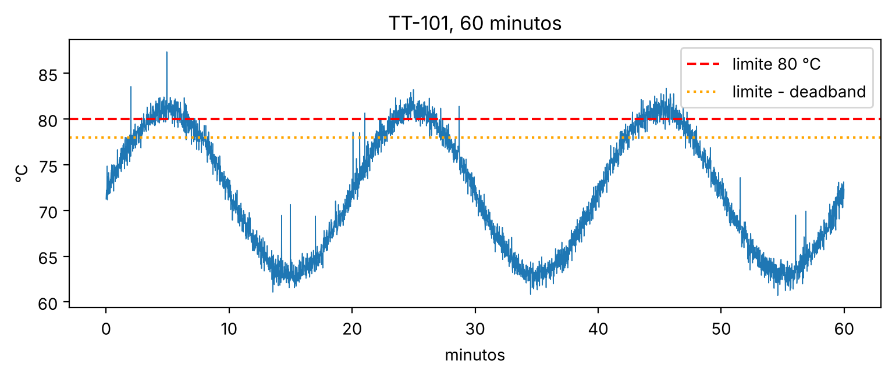
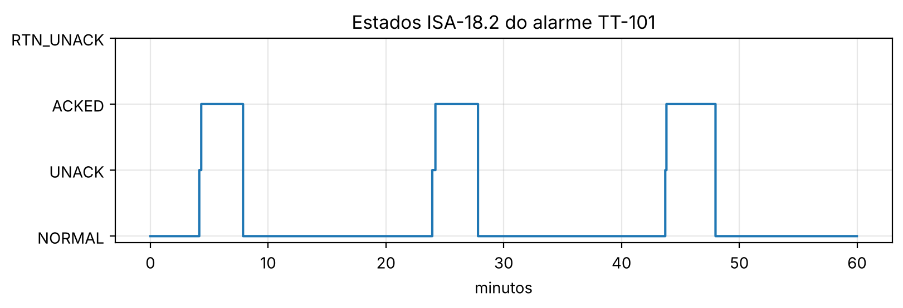

# IIoT Protocols by Example

**A ten-lesson course on the protocols and patterns behind industrial data, where every lesson is code that runs on a laptop.**

Modbus, OPC UA, MQTT, Unified Namespace, Sparkplug B, edge gateways, historians, OEE and alarm management. Each example simulates its own device, needs no hardware, prints what it is demonstrating, and runs as a test in CI. Each one also has a study notebook in Portuguese, already executed, with the outputs kept and explained.

[](https://github.com/MatheusEduGarcia/iiot-protocols-examples/actions/workflows/ci.yml)


---

## Contents

1. [The learning path](#the-learning-path)
2. [The ten lessons](#the-ten-lessons)
3. [How each notebook teaches](#how-each-notebook-teaches)
4. [What you will see](#what-you-will-see)
5. [Setup](#setup)
6. [Tests and configuration](#tests-and-configuration)

---

## The learning path

The lessons follow a signal from the device to a business indicator. Take them in order the first time; each one ends with a link to the next.



| Stage | Question it answers | Time |
|---|---|---|
| 1 · Field | How do I read and write a device, and why do the numbers look wrong? | about 1 h |
| 2 · Modelled data | How does a server describe its own data, and how do I receive only what changes? | about 1 h |
| 3 · Messaging | How does one source reach many consumers reliably, and how is the plant organized in topics? | about 1 h 15 |
| 4 · Integration and value | How do these pieces become a gateway, an OEE number and usable alarms? | about 1 h 40 |

## The ten lessons

| # | Lesson | You learn to | Code | Study notebook (pt-BR) |
|---|---|---|---|---|
| 01 | Modbus TCP basics | pick the function code for each table, scale raw values, close an on/off loop with hysteresis | [folder](01-modbus-tcp-basics/) | [notebook](01-modbus-tcp-basics/01_estudo_modbus_tcp.ipynb) |
| 02 | Modbus data types and RTU framing | rebuild float32 and int32 in both word orders, handle 4-20 mA with wire-break detection, read a frame byte by byte | [folder](02-modbus-data-types-rtu/) | [notebook](02-modbus-data-types-rtu/02_estudo_tipos_de_dados_rtu.ipynb) |
| 03 | OPC UA server with an information model | browse an address space, read type, unit, range and access from the server, use methods instead of raw writes | [folder](03-opcua-server-model/) | [notebook](03-opcua-server-model/03_estudo_servidor_opcua.ipynb) |
| 04 | OPC UA client | replace polling with subscriptions and choose a deadband from the signal noise | [folder](04-opcua-client-subscriptions/) | [notebook](04-opcua-client-subscriptions/04_estudo_cliente_opcua.ipynb) |
| 05 | MQTT QoS, retain and Last Will | decide when to retain, detect a dead device through the broker, keep messages for an offline consumer | [folder](05-mqtt-qos-retain-lwt/) | [notebook](05-mqtt-qos-retain-lwt/05_estudo_mqtt_qos_retain_lwt.ipynb) |
| 06 | Unified Namespace | design an ISA-95 topic tree and write `+` and `#` filters for different consumers | [folder](06-unified-namespace/) | [notebook](06-unified-namespace/06_estudo_unified_namespace.ipynb) |
| 07 | Sparkplug B | read birth, data and death messages, explain `seq`, `bdSeq` and aliases, compare protobuf with JSON | [folder](07-sparkplug-b/) | [notebook](07-sparkplug-b/07_estudo_sparkplug_b.ipynb) |
| 08 | Modbus to MQTT gateway | build a tag table with deadband and heartbeat, measure report by exception, publish bad quality | [folder](08-modbus-to-mqtt-gateway/) | [notebook](08-modbus-to-mqtt-gateway/08_estudo_gateway_modbus_mqtt.ipynb) |
| 09 | Historian and OEE | turn state changes and counters into durations, a downtime Pareto and Availability x Performance x Quality with SQL window functions | [folder](09-historian-and-oee/) | [notebook](09-historian-and-oee/09_estudo_historiador_oee.ipynb) |
| 10 | Alarm management (ISA-18.2) | stop an alarm flood with deadband and delays, follow the alarm state machine, use shelving safely | [folder](10-alarms-isa-18-2/) | [notebook](10-alarms-isa-18-2/10_estudo_alarmes_isa_18_2.ipynb) |

## How each notebook teaches

All ten notebooks are committed **already executed**, so they read on GitHub without installing anything, and they share one structure:

| Block | What it is for |
|---|---|
| **Antes de começar** | who it is for, prerequisites, time, what you will be able to do, where it shows up in a plant, and one analogy to hold on to |
| **Concept, then experiment** | a short explanation followed by a cell that proves it, with the real output kept |
| **Pare e preveja** | before the key experiments, a question to answer before running the cell |
| **Interpretação** | what the output means, right under it |
| **Erros comuns** | the mistakes that cost hours in commissioning |
| **Teste seu entendimento** | three questions with answers hidden behind a click |
| **Exercícios** | small changes to try, with what to observe |
| **Glossário** and **Próximo passo** | the vocabulary of the lesson and the link to the next one |

The didactic layer lives in [`tools/didatico_conteudo.py`](tools/didatico_conteudo.py) and is applied with `python tools/didatico.py tools/didatico_conteudo.py .`, so it survives re-running a notebook.

## What you will see

A few results from the executed notebooks.

**Lesson 01.** A client closes a level loop over Modbus TCP. The pump turns off above the setpoint band and the level settles.



**Lesson 04.** The same variable with and without a deadband: 17 notifications against 1 in eight seconds.



**Lesson 08.** The gateway read the device 280 times and published 28 messages, 90 % less traffic, with the level still faithfully described.



**Lesson 09.** Where the shift went: the OEE and its three losses, computed in SQL from raw state changes and counters.



**Lesson 10.** One noisy temperature signal and one alarm. A plain limit fires 141 times in an hour; the ISA-18.2 configuration fires 3 times.




## Setup

```bash
git clone https://github.com/MatheusEduGarcia/iiot-protocols-examples.git
cd iiot-protocols-examples
python -m venv .venv && source .venv/bin/activate      # Windows: .venv\Scripts\activate
pip install -r requirements.txt
docker compose up -d          # MQTT broker for lessons 05 to 09 (or any broker on localhost:1883)
```

Run any example from the repository root:

```bash
python 02-modbus-data-types-rtu/datatypes.py
```

Examples 01, 03 and 08 need a server running in another terminal; their README says which. To study with the notebooks, run `jupyter lab` from the repository root. The notebooks start their own Modbus and OPC UA servers in the background.

## Tests and configuration

```bash
pytest -v tests
```

The suite starts the Modbus and OPC UA servers itself and skips the MQTT examples if no broker is listening on `localhost:1883`.

| Variable | Default | Used by |
|---|---|---|
| `MQTT_HOST`, `MQTT_PORT` | `localhost`, `1883` | 05 to 09 |
| `MODBUS_HOST`, `MODBUS_PORT` | `localhost`, `5020` | 01, 08 |
| `OPCUA_URL` | `opc.tcp://localhost:4841/iiot-examples/` | 04 |

## Where to go next

| Repository | What it adds |
|---|---|
| [compressed-air-plant-opcua](https://github.com/MatheusEduGarcia/compressed-air-plant-opcua) | these protocols together in one plant: PLC, OPC UA, UNS, TimescaleDB, Grafana |
| [industrial-ontology-lab](https://github.com/MatheusEduGarcia/industrial-ontology-lab) | meaning for the data: ontology, knowledge graph, data contracts |
| [ot-security-lab](https://github.com/MatheusEduGarcia/ot-security-lab) | protection for the network these protocols run on: IEC 62443 in practice |
| [automation-portfolio](https://github.com/MatheusEduGarcia/automation-portfolio) | the index of all projects, plus ESP32 and Node-RED work |

## Author

**Matheus Garcia**, Control and Automation Engineer, OT/IT integration and industrial data. [LinkedIn](https://www.linkedin.com/in/matheuseduardorgarcia)

MIT License
